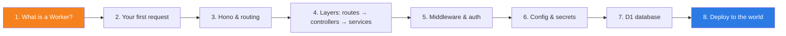
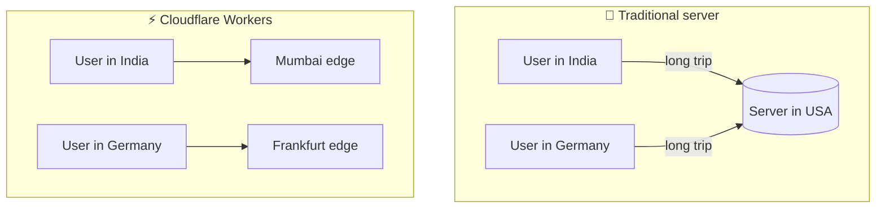
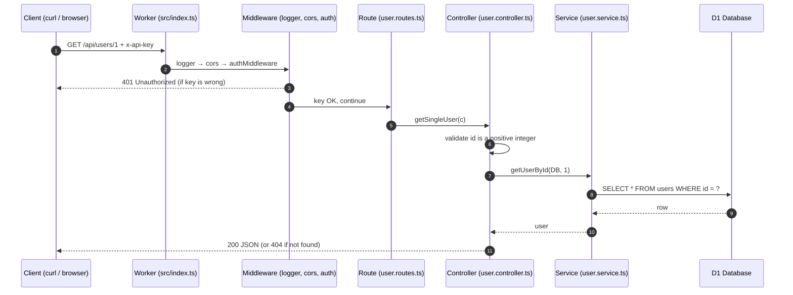
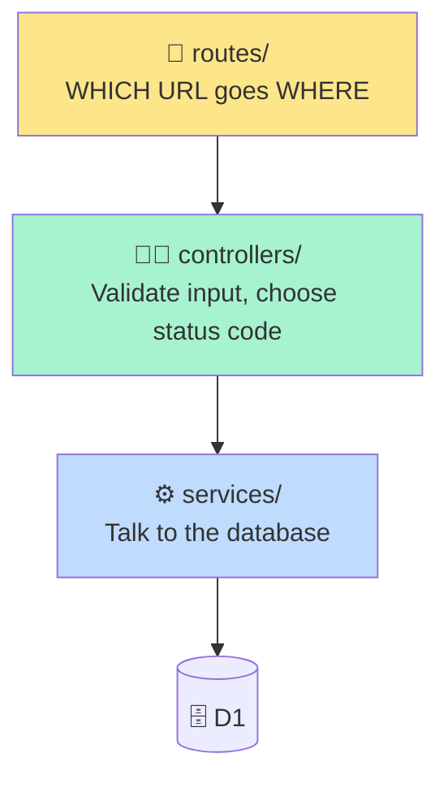
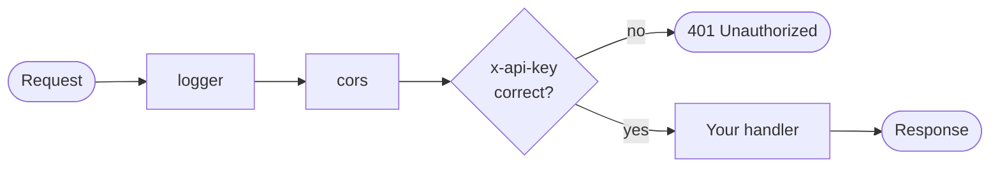
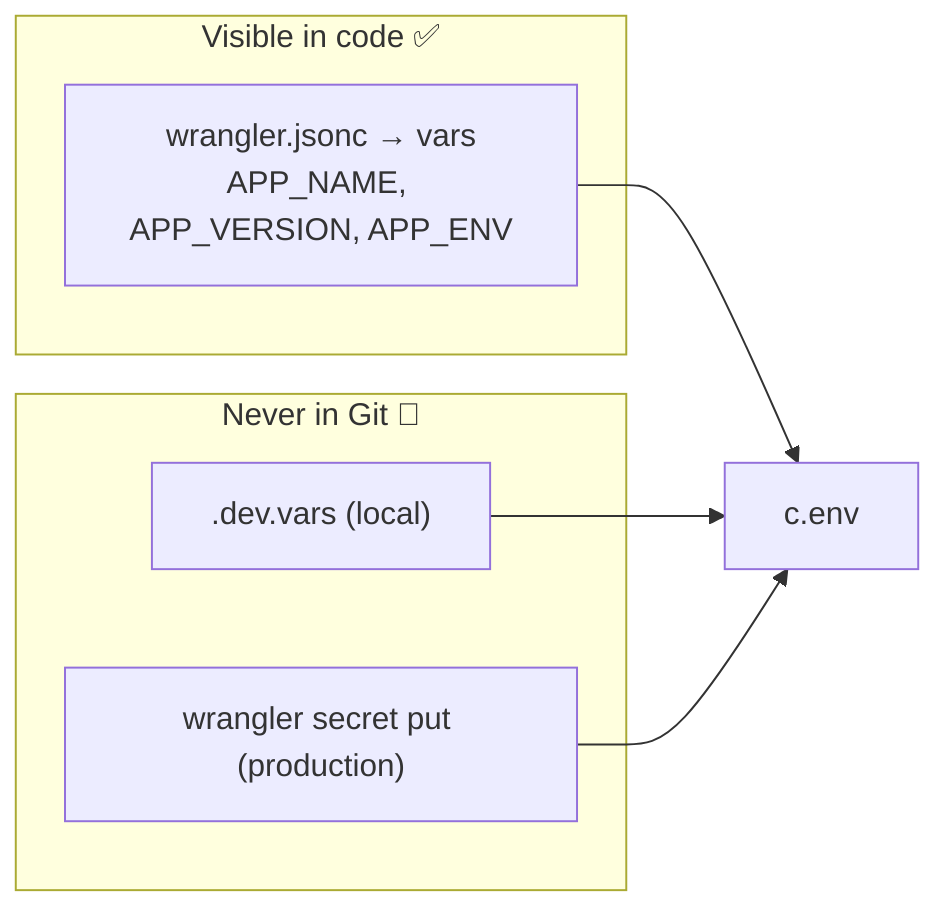
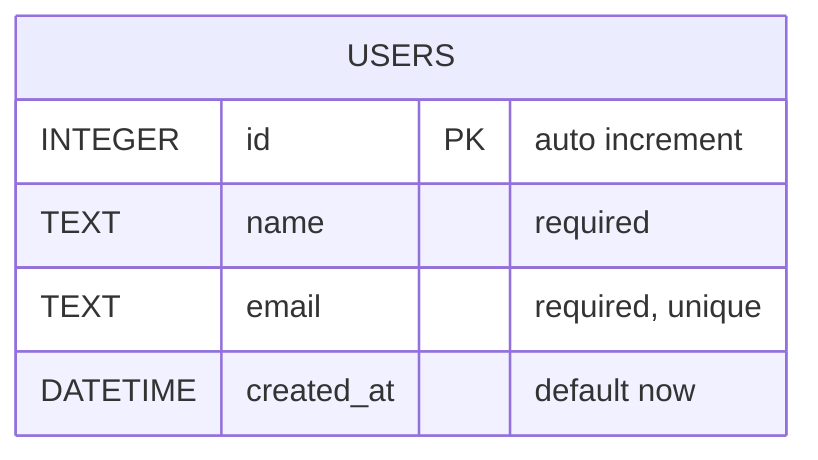
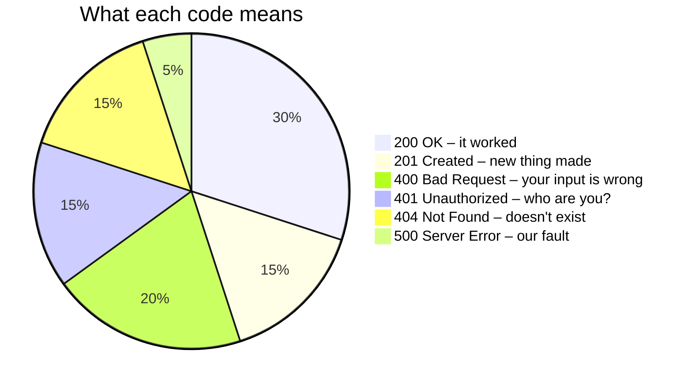
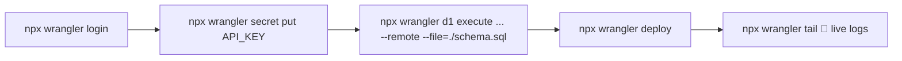

# 🎓 Learn Cloudflare Workers With This Project

> Welcome, student! 👋 I'm going to be your teacher for this lesson.
> We won't just *read* about Cloudflare — we'll take apart **this exact project**, piece by piece,
> until you could build it yourself from a blank folder.
>
> Each lesson ends with a ✏️ **Exercise** and a ✅ **Check yourself** question. Please don't skip them — that's where the learning happens.

---

## 🗺️ Course Map



---

## Lesson 1 — What is a Cloudflare Worker? 🌍

Imagine a traditional server as **one restaurant** in one city. Everyone in the world has to travel there to eat.

A Worker is like a **recipe sent to 300+ kitchens worldwide**. Whoever is hungry gets served by the kitchen closest to them.



**Key ideas to remember:**

| Idea | What it means for you |
|------|----------------------|
| **Serverless** | No machine to manage. You upload code, Cloudflare runs it. |
| **Edge** | Code runs close to the user → fast responses. |
| **Stateless** | Each request may hit a *different* copy of your Worker. Don't keep data in variables — use a database (D1, KV…). |
| **Fetch API** | A Worker receives a `Request` and returns a `Response`. That's it! |

✅ **Check yourself:** Why is `let counter = 0; counter++` a *bad* way to count visitors in a Worker?
<details><summary>Answer</summary>Each edge location (and each restart) has its own memory, so the counter resets and differs everywhere. Persistent data belongs in storage like D1.</details>

---

## Lesson 2 — The life of a request 🔁

Here is *exactly* what happens when someone calls `GET /api/users/1` on this project:



Read that diagram twice. Every backend you'll ever build follows this shape.

---

## Lesson 3 — Hono: a tiny router 🔥

Plain Workers make you write `if (url.pathname === ...)` for every route. **Hono** does that for you.

Open [src/index.ts](src/index.ts):

```ts
const app = new Hono<AppEnv>();

app.get("/", (c) => c.json({ message: "Cloudflare Backend Running" }));
app.route("/api/users", userRoutes);   // plug in a group of routes
export default app;                     // Cloudflare calls app.fetch()
```

👉 `c` is the **context**: it holds the request (`c.req`), the environment (`c.env`), and helpers to respond (`c.json`).

✏️ **Exercise:** Add `GET /api/hello/:name` that returns `{ "greeting": "Hello, <name>!" }`.
Hint: `c.req.param("name")`.

---

## Lesson 4 — Organizing code in layers 🧱

A good chef doesn't take orders, cook, *and* wash dishes at the same time. Neither should your code.



| Folder | Job | Example in this project |
|--------|-----|-------------------------|
| [src/routes/](src/routes/) | Map URL + method → controller | `userRoutes.put("/:id", controller.updateUser)` |
| [src/controllers/](src/controllers/) | Check input, decide 200/400/404 | `getSingleUser` rejects `id = -5` with 400 |
| [src/services/](src/services/) | SQL only, no HTTP | `getUserById(db, id)` |
| [src/middleware/](src/middleware/) | Runs before handlers | `authMiddleware` |
| [src/types/](src/types/) | Type of `c.env` | `AppEnv` |

✅ **Check yourself:** Where would you add "email must end with `.com`"? 
<details><summary>Answer</summary>In the controller — it's input validation, not database logic.</details>

---

## Lesson 5 — Middleware: the security guard 🛡️

Middleware runs **before** your handler, like a guard at the door.



From [src/middleware/auth.middleware.ts](src/middleware/auth.middleware.ts):

```ts
if (!c.env.API_KEY || apiKey !== c.env.API_KEY) {
    return c.json({ message: "Unauthorized" }, 401); // stop here
}
await next();                                        // let them in
```

> ⚠️ **Teacher's note:** An API key is a *learning* tool, not real user login. And **CORS is not security** — it only tells browsers who may read responses.

---

## Lesson 6 — Config vs. secrets 🔐



- **vars** → harmless settings. Try `GET /api/config`.
- **secrets** → `API_KEY`. Locally in `.dev.vars`, in production via `npx wrangler secret put API_KEY`.
- After changing bindings, run `npx wrangler types` so TypeScript knows about them.

✅ **Check yourself:** Is `.dev.vars` in [.gitignore](.gitignore)? Go look! It must be.

---

## Lesson 7 — D1: a real database 🗄️

D1 is SQLite running on Cloudflare. The Worker reaches it through a **binding** named `DB` (see `d1_databases` in [wrangler.jsonc](wrangler.jsonc)).



Set it up locally:

```bash
npx wrangler d1 execute cloudflare-learning-db --local --file=./schema.sql
npx wrangler d1 execute cloudflare-learning-db --local --command="SELECT * FROM users"
```

### 🚨 The most important rule: always bind parameters

```ts
// ❌ NEVER — SQL injection: a user could send  1; DROP TABLE users
db.prepare(`SELECT * FROM users WHERE id = ${id}`)

// ✅ ALWAYS — what this project does
db.prepare("SELECT * FROM users WHERE id = ?").bind(id)
```

### CRUD ↔ HTTP ↔ SQL cheat sheet

| Action | HTTP | SQL | Success code |
|--------|------|-----|------|
| Create | `POST /api/users` | `INSERT` | 201 |
| Read | `GET /api/users/:id` | `SELECT` | 200 |
| Update | `PUT /api/users/:id` | `UPDATE` | 200 |
| Delete | `DELETE /api/users/:id` | `DELETE` | 200 |

> 💡 **Local vs remote:** `--local` and `--remote` are *two different databases*. Deploying code never copies your local data.

✏️ **Exercise:** Add `GET /api/users?search=vi` that returns users whose name contains the text. (Hint: `LIKE ?` with `.bind(\`%${search}%\`)`.)

---

## Lesson 8 — Try it yourself 🧪

Start the server:

```bash
npm install
echo 'API_KEY="my-local-test-key"' > .dev.vars
npm run dev          # http://localhost:8787
```

Then experiment (PowerShell uses `curl.exe`):

```bash
curl.exe http://localhost:8787/
curl.exe http://localhost:8787/api/config
curl.exe -i http://localhost:8787/api/users                                   # 401 — no key
curl.exe -H "x-api-key: my-local-test-key" http://localhost:8787/api/users    # 200
curl.exe -i -H "x-api-key: my-local-test-key" http://localhost:8787/api/users/abc   # 400
curl.exe -i -H "x-api-key: my-local-test-key" http://localhost:8787/api/users/999   # 404
```

Create a user:

```bash
curl.exe -X POST http://localhost:8787/api/users `
  -H "x-api-key: my-local-test-key" -H "Content-Type: application/json" `
  -d '{\"name\":\"Asha\",\"email\":\"asha@example.com\"}'
```

### Status codes you just met



---

## Lesson 9 — Ship it 🚀



Your code is now running on Cloudflare's global network. 🎉

---

## 🏆 Final Project (homework)

Put everything together:

1. Add a `posts` table (`id`, `user_id`, `title`, `body`).
2. Add `GET/POST /api/users/:id/posts` following the routes → controller → service pattern.
3. Return **400** for bad input, **404** if the user doesn't exist.
4. Use `.bind()` for every value.
5. Deploy it and share your URL!

## 📝 Quick Quiz

1. Where does `c.env.DB` come from? 
2. Why do services never call `c.json()`? 
3. What's the difference between `vars` and secrets? 
4. What happens to your local D1 data when you deploy?

<details><summary>Answers</summary>

1. The `d1_databases` binding in `wrangler.jsonc`.
2. Services handle data only; HTTP decisions belong in controllers — this keeps them reusable and testable.
3. Vars are public config in code; secrets are encrypted and never committed.
4. Nothing — it stays local. Remote is a separate database.
</details>

---

## 📚 Keep learning

- [Cloudflare Workers docs](https://developers.cloudflare.com/workers/)
- [Workers limits](https://developers.cloudflare.com/workers/platform/limits/)
- [D1 docs](https://developers.cloudflare.com/d1/)
- [Hono docs](https://hono.dev/)

> *"Tell me and I forget, teach me and I may remember, involve me and I learn."* — so go do the exercises! 💪
